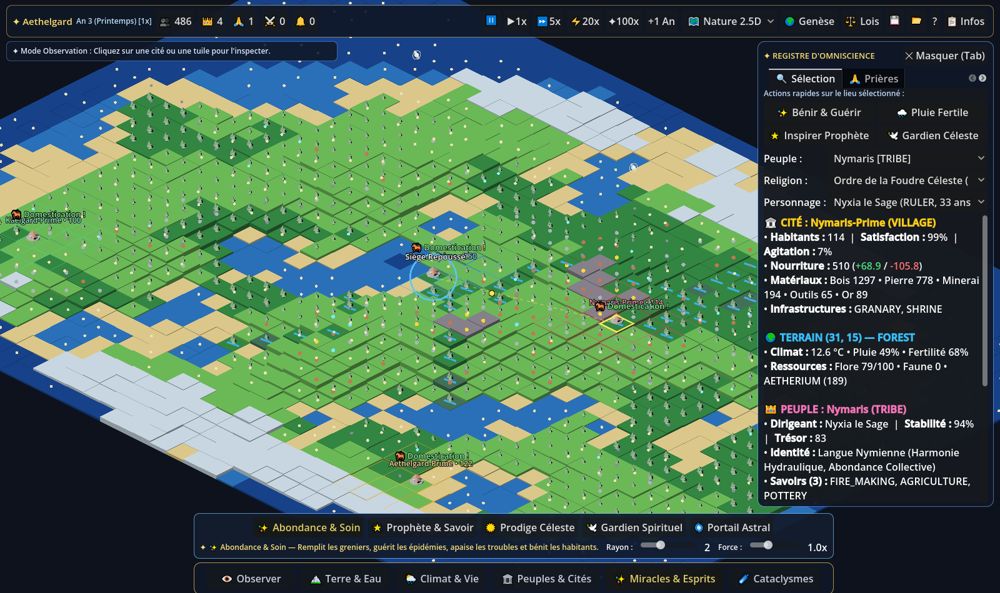

# ✦ GENESIS — THE DIVINE SIMULATION

[](https://github.com/SoKie777/genesis-divine-sim/actions/workflows/android-apk.yml)
[](https://github.com/SoKie777/genesis-divine-sim/releases/latest)

**GENESIS — The Divine Simulation** est un jeu de simulation divine systémique, émergent et multi-échelle développé sous **Godot 4** (compatible **Android Tactile** & **PC**) avec des assets 3D isométriques générés sous **Blender 5.2**.

Vous incarnez une divinité toute-puissante face à un monde véritablement autonome : même si vous restez silencieux pendant des siècles, les peuples se nourrissent, commercent par caravanes, domestiquent la faune, fondent des colonies, inventent des technologies, créent des religions, subissent des schismes, concluent des alliances, se font la guerre et vous adressent leurs prières.



---

## 📱 Télécharger et Installer sur Android (APK)

Chaque `push` sur la branche `main` exécute automatiquement la suite de tests scientifiques du moteur puis compile et signe l'application Android via **GitHub Actions** :

1. **Via GitHub Releases (Recommandé) :**
   👉 **[Télécharger `genesis-divine-sim.apk` (Dernière Release v1.0.0)](https://github.com/SoKie777/genesis-divine-sim/releases/latest)**
2. **Via GitHub Actions Artifacts :**
   Rendez-vous dans l'onglet **[Actions](https://github.com/SoKie777/genesis-divine-sim/actions/workflows/android-apk.yml)** → cliquez sur le dernier build vert → téléchargez l'artefact **`genesis-divine-sim-android-apk`**.

### Contrôles Tactiles Android & PC

| Action | Sur Android (Écran Tactile) | Sur PC (Souris & Clavier) |
| :--- | :--- | :--- |
| **Déplacer la caméra** | En mode `👁 Observer`, glisser à **1 doigt** (ou **2 doigts** à tout moment) | `Clic Droit + Glisser` ou touches `ZQSD` / `Flèches` |
| **Zoomer / Dézoomer** | **Pincer à 2 doigts** (*Pinch-to-Zoom*) ou boutons `➕` / `➖` en haut | `Molette de la souris` ou boutons `➕` / `➖` |
| **Inspecter une cité / terre** | En mode `👁 Observer`, **toucher** une cité ou une tuile | En mode `👁 Observer`, `Clic Gauche` sur une cité / tuile |
| **Exercer un pouvoir divin** | Toucher une famille dans le **Dock du bas**, choisir un pouvoir, puis **toucher/glisser** sur la carte | Choisir un pouvoir dans le **Dock du bas**, puis `Clic Gauche` sur la carte |
| **Actions divines en 1 clic** | Toucher une cité puis utiliser les **4 boutons rapides** dans le volet droit | Cliquer sur une cité puis utiliser les **4 boutons rapides** |
| **Masquer/Afficher le volet droit** | Bouton `✕ Masquer` ou `📋 Infos` en haut à droite | Touche `Tab` ou bouton `✕ Masquer` |

---

## ⚡ Les 5 Piliers Systémiques du Jeu

1. **Autonomie Totale :** Aucune population n'attend un clic du joueur. Les saisons, la biomasse, la faune, l'agriculture, l'artisanat (transformation du minerai et du bois en outils), les caravanes marchandes, la démographie et la géopolitique progressent continuellement.
2. **Profondeur Causale :** Un changement climatique (sécheresse ou éruption volcanique) affecte la fertilité, réduit les récoltes, vide les greniers, déclenche la famine, provoque des migrations de réfugiés, fait monter l'agitation sociale, génère des prières d'urgence et déstabilise les royaumes.
3. **Toute-Puissance Divine (20 Pouvoirs & Lois de la Nature) :**
   - **🏔 Terre & Eau :** *Élever Terre/Montagne*, *Creuser Mer/Vallée*, *Source & Fleuve*, *Filon Minéral*.
   - **🌦 Climat & Vie :** *Pluie Fertile*, *Sécheresse*, *Forêt Primordiale*, *Créer Faune*.
   - **🏛 Peuples & Cités :** *Fonder Peuple*, *Âge d'Or Marchand & Caravanes*, *Monument Sacré*.
   - **✨ Miracles & Esprits :** *Abondance & Soin*, *Prophète & Savoir*, *Prodige Céleste*, *Gardien Spirituel*, *Portail Astral*.
   - **☄ Cataclysmes :** *Météore & Séisme*, *Volcan & Cendres*, *Pestilence*.
   - **⚖ Lois de la Nature (en temps réel) :** Modifiez la longévité biologique, la régénération écologique, la fertilité globale, la volatilité climatique, la propension aux conflits et l'ascension des saints/prophètes en esprits après leur mort.
4. **Vérité Objective vs Interprétations Mortelles :** Vous savez ce que vous avez provoqué, mais les civilisations l'interprètent selon leur culture, leur foi et leur niveau scientifique (miracle d'élection divine, jugement céleste, présage politique ou anomalie physique étudiée par les académies).
5. **Lisibilité & Diagnostic Scientifique :** 8 couches cartographiques analytiques en temps réel (*Nature 2.5D, Frontières, Religions, Population, Fertilité, Richesse, Relief, Climat °C*), chroniques causales détaillées et panneau de diagnostic expliquant chaque décision de l'IA.

---

## 🏗️ Architecture Technique du Projet

```text
genesis-divine-sim/
├── .github/workflows/
│   └── android-apk.yml                 # Pipeline CI/CD : Tests Headless + Build & Release APK Android
├── assets/sprites/                     # Sprites 3D isométriques générés via Blender 5.2
├── scenes/
│   └── main.tscn                       # Scène principale (PC & Android)
├── scripts/
│   ├── core/
│   │   ├── deterministic_rng.gd        # RNG déterministe multi-canal (9 flux isolés)
│   │   └── world_state.gd              # État pur sérialisable (JSON versionné)
│   ├── systems/
│   │   ├── world_generator.gd          # Génération procédurale par graine (continents, fleuves, biomes)
│   │   ├── ecology_climate_system.gd   # Climat saisonnier, biomasse, faune et entités spirituelles
│   │   ├── economy_population_system.gd# Production/consommation réelle, caravanes, démographie, colonies
│   │   ├── culture_religion_system.gd  # Individus, technologies, religions (10 composantes), schismes, prières
│   │   ├── geopolitics_military_system.gd # Régimes, révolutions, diplomatie, logistique et sièges
│   │   ├── divine_power_system.gd      # Exécution des 20 pouvoirs, lois naturelles et réponses aux prières
│   │   ├── save_system.gd              # Sauvegarde/chargement avec vérification de checksum
│   │   └── world_simulation.gd         # Orchestrateur temporel multi-fréquence et vérification d'invariants
│   └── ui/
│       ├── isometric_world_renderer.gd # Rendu 2.5D isométrique + Multi-Touch Android + 8 couches analytiques
│       └── main_game.gd                # Interface divine épurée, dock inférieur et volet escamotable
├── tests/
│   └── test_simulation.gd              # Suite de 5 tests scientifiques automatisés (Headless)
├── tools/
│   └── generate_blender_isometric_assets.py # Script Python Blender 5.2 de génération des sprites 3D
├── export_presets.cfg                  # Configuration d'export Android APK
└── project.godot                       # Configuration Godot 4 (GL Compatibility Mobile & Desktop)
```

---

## 🧪 Exécuter le Jeu ou les Tests en Local

- **Lancer le jeu sur PC :**
  Double-cliquez sur `run_genesis.bat` ou exécutez :
  ```bash
  godot --path .
  ```
- **Exécuter la suite de vérification scientifique (5 tests automatisés en mode Headless) :**
  ```bash
  godot --headless --path . -s res://tests/test_simulation.gd
  ```
